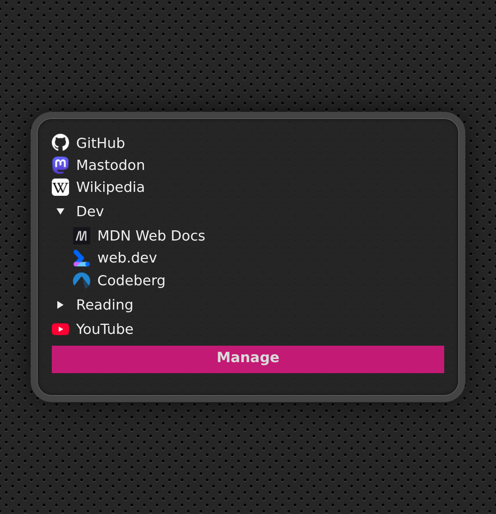
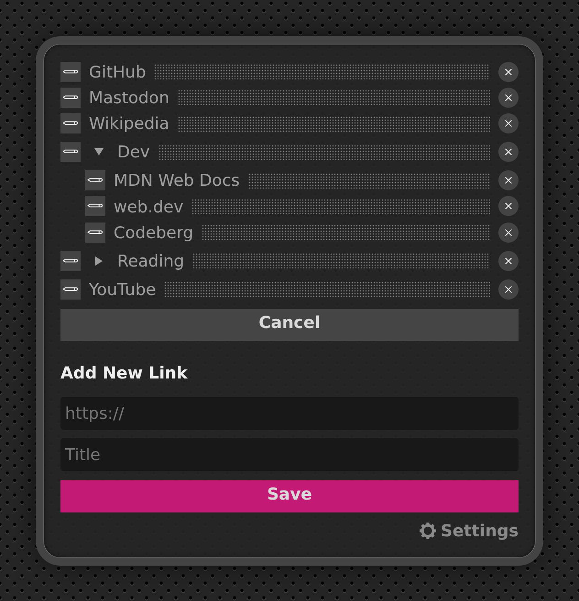

Karl Marks is a Chrome browser extension that provides a custom new-tab-page for your most common bookmarks.

It loads extremely fast, you can drag & drop bookmarks into groups or on the list. You can sync your bookmarks and settings or keep things local. Karl Marks is open source and respects your privacy.

## [](https://chromewebstore.google.com/detail/karl-marks/odkohchphnbfhpnpidbfgcmfmomeaaeo) [Install from Chrome Webstore](https://chromewebstore.google.com/detail/karl-marks/odkohchphnbfhpnpidbfgcmfmomeaaeo)

 ## Features
  - Themes: bright / dark / match system
  - 2 separate data stores: local / synced
  - no dependencies, no frameworks, loads instantly
  - create, edit, sort and delete your bookmarks
  - collapsible, nameable groups: drop one bookmark onto another
  - favicons from browser cache
  - backup & import in JSON format

## Screenshots
 

## Alternatively install from GitHub
To get extension updates in Chromium builds like [ungoogled-chromium](https://github.com/KolyaKorruptis/chromium-py-updater):<br>
First install the [chromium-web-store](https://github.com/NeverDecaf/chromium-web-store) extension. It will update your extensions (from Chrome Webstore as well as Github).<br>
Then you can either install the extension from the [Chrome Webstore](https://chromewebstore.google.com/detail/karl-marks/odkohchphnbfhpnpidbfgcmfmomeaaeo).<br>
Or forgo Google and [download KarlMarks.crx](https://github.com/KolyaKorruptis/KarlMarks/releases/latest/download/KarlMarks.crx) from the latest Github release instead. Then drag it onto the `chrome://extensions` page to install.<br>

The GitHub version is a separate extension from the store version, with its own bookmarks and settings. Use the  Backup and Import functions in the extension settings to move your bookmarks over.

## Development
The extension itself has no dependencies. The browser test uses `playwright-core`:

```
npm install
npx playwright-core install chromium   # once
npm test
npm run screenshots   # regenerates screenshots/, needs network access for the favicons
npm run screenshots -- --store   # 1280x800 images for the Chrome Web Store, saved to .Google-Store-Images/
```

### Releasing
1. Bump `version` in `manifest.json`.
2. `npm run build` saves `dist/KarlMarks-x.y.z.zip` for the Chrome Web Store and `dist/KarlMarks.crx` for GitHub installs, and writes `updates.xml`.
3. Commit `manifest.json` and `updates.xml`, push, and create the release `vx.y.z` with `dist/KarlMarks.crx` as its only asset.
4. Upload `dist/KarlMarks-x.y.z.zip` to the Chrome Web Store, it doesn't go into the release.

The crx is signed with `~/.config/karlmarks/karlmarks.pem`. The key fixes the GitHub version's extension ID: keep a backup, without it GitHub installs get no more updates. Without the key, `npm run build` only makes the store zip.
