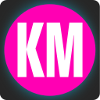
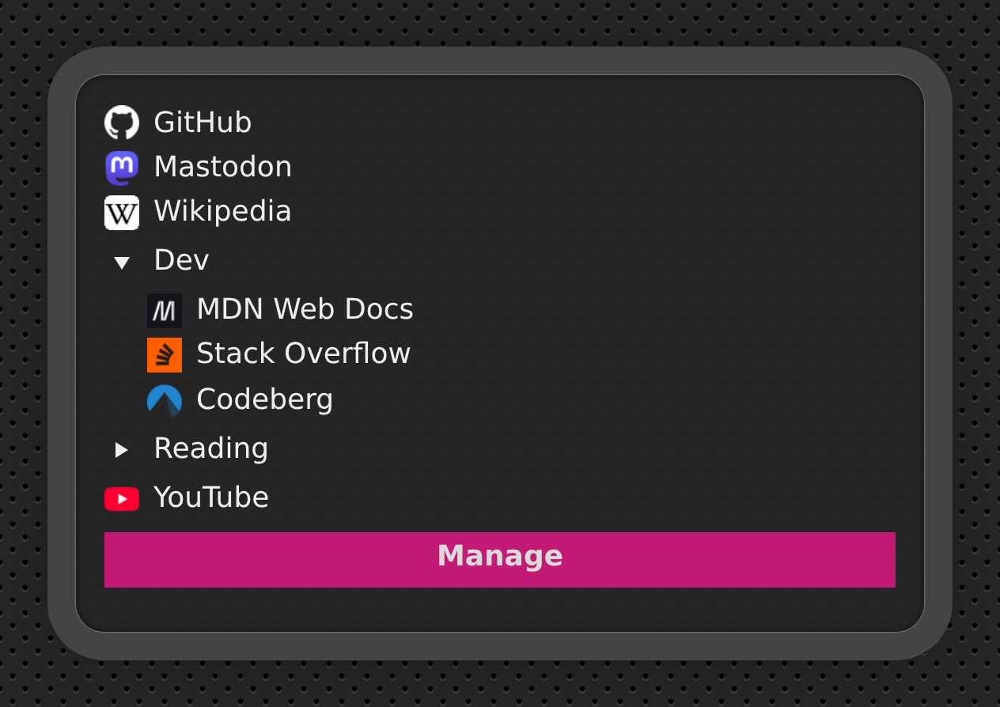
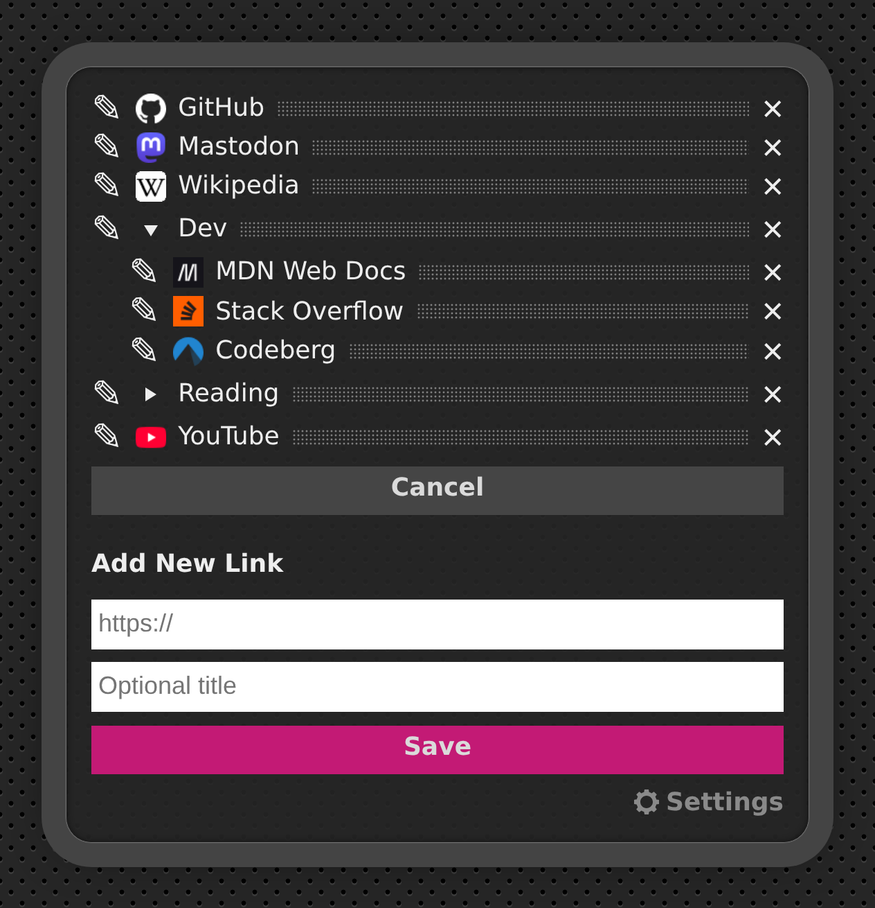

Karl Marks is a Chrome browser extension that brings a custom new-tab-page.

It has drag & drop bookmarks and dark/light mode support. You can sync your bookmarks and settings or keep things local. Karl Marks is fast and open source and respects your privacy: favicons come from your browser's own cache instead of a web service.
 ## Features
  - Themes: bright / dark / match system
  - 2 separate data stores: local / synced
  - no dependencies, no frameworks, loads instantly
  - create, sort, edit and delete your bookmarks
  - collapsible, nameable groups: drop one bookmark onto another
  - favicons from the browser's cache
  - backup & import in JSON format

## [Install from Chrome Webstore](https://chromewebstore.google.com/detail/karl-marks/odkohchphnbfhpnpidbfgcmfmomeaaeo)

## Screenshots
 

## Development
The extension itself has no dependencies. The browser test uses `playwright-core`:

```
npm install
npx playwright-core install chromium   # once
npm test
npm run screenshots   # regenerates screenshots/, needs network access for the favicons
```

When packaging for the Chrome Web Store, zip only `manifest.json`, `index.html`, `css/`, `js/` and `icons/`.
